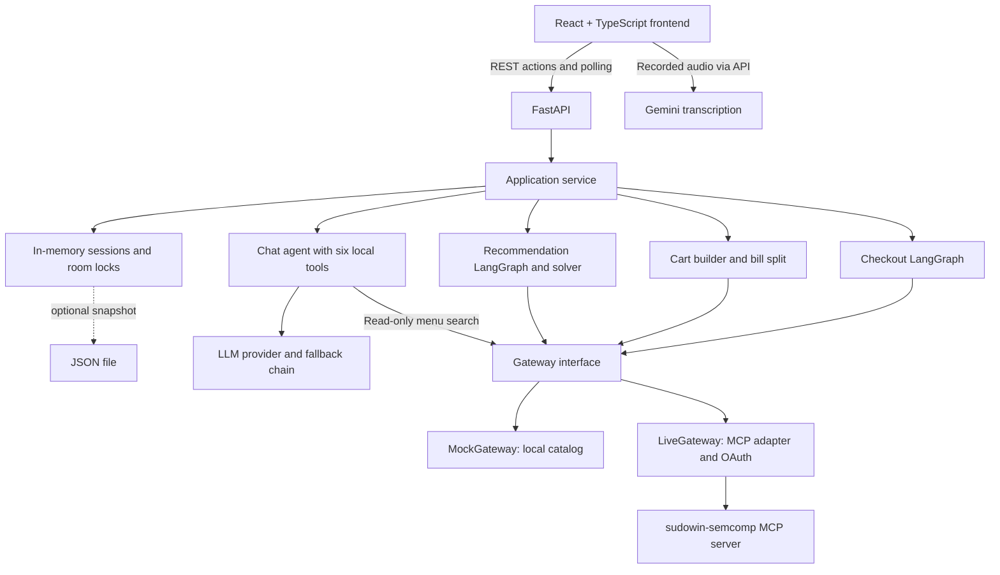
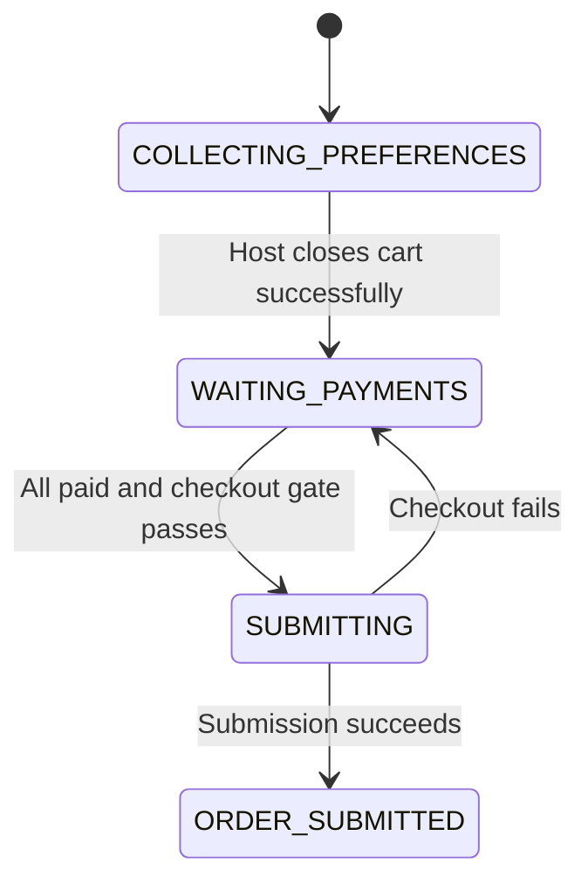

# Project architecture

This repository contains **iFood Mesa**, a group food-ordering prototype, and a separate command-line tool-calling agent. Mesa lets people share a room, describe preferences, find a common restaurant, choose individual dishes, split the bill, and submit one order through the iFood MCP server.

The LLM handles conversation and structured preference updates. Python code controls restaurant matching, item validation, cart construction, bill splitting, and checkout.

## System overview



The frontend polls room state every **1.5 seconds** and order tracking every **6 seconds** after submission. There are no WebSockets, database server, or external task queue.

## Code map

| Path | Responsibility |
|---|---|
| `frontend/src/App.tsx` | Room loading, viewer identity, polling, and view coordination. |
| `frontend/src/api.ts`, `types.ts` | HTTP client and TypeScript representations of backend JSON. |
| `frontend/src/components/` | Room entrance, chat, composer, restaurant selector, recommendations, cart, and event timeline. |
| `frontend/src/audio.ts` | Browser microphone recording support. |
| `src/agent/mesa/api.py` | FastAPI routes, request validation, error responses, and optional static hosting. |
| `src/agent/mesa/service.py` | Application operations, role checks, background tasks, cancellation, and lifecycle coordination. |
| `src/agent/mesa/models.py` | Pydantic session, member, recommendation, cart, chat, and event models. |
| `src/agent/mesa/store.py` | Process-local sessions, room locks, optional JSON snapshots, and event/chat helpers. |
| `src/agent/mesa/chat.py` | Author-bound conversational agent, local tools, usage logging, and fallback handling. |
| `src/agent/mesa/intents.py` | Search queries, exclusions, and price ceilings extracted from preferences. |
| `src/agent/mesa/recommend_graph.py` | Recommendation workflow, candidate cache, publication, and failures. |
| `src/agent/mesa/solver.py` | Bounded discovery, common restaurant selection, wish matching, extras, and item validation. |
| `src/agent/mesa/context.py` | Delivery address resolution and search coordinates. |
| `src/agent/mesa/cart.py` | Remote cart creation, vouchers, delivery/payment setup, and totals. |
| `src/agent/mesa/split.py` | Exact allocation of item costs, delivery, and discounts. |
| `src/agent/mesa/checkout_graph.py` | Payment gate, submission, order details, and tracking. |
| `src/agent/mesa/gateway.py` | Common MCP interface, live calls, payload cleanup, and error normalization. |
| `src/agent/mesa/mock_data.py` | Mock catalog, carts, and orders. |
| `src/agent/mesa/parsing.py` | Decoding and extraction of external MCP payloads. |
| `src/agent/mesa/audio.py` | Audio validation and Gemini transcription. |
| `src/agent/providers.py` | Model configuration, retries, empty-response protection, and provider fallbacks. |
| `src/agent/mcp.py`, `oauth.py` | MCP tool loading and OAuth token management. |
| `src/agent/graph.py`, `main.py`, `tools.py` | Separate CLI agent, entry point, and local tools. |
| `tests/` | Mock-based domain and workflow tests. |
| `scripts/` | Tool inventory and explicit live, read-only search/solver probes. |

## Frontend and room identity

The frontend uses React, TypeScript, and Vite. `RoomEntrance` creates a room or joins an existing room using a code or invitation URL (`?mesa=CODE`). The server returns the session and member ID; the browser remembers that ID in a room-specific `localStorage` entry.

**True mode** shows the current participant's conversation, personal suggestions, restaurant selection, and shared cart. **God mode** shows simulated participant devices and event inspection. These UI modes are independent of mock/live backend integration mode.

`OrderDock` groups `RestaurantBar`, `RecommendationStrip`, and `CartBar`. The backend publishes multiple recommendations in a flat list, with each entry carrying its `memberId`. Selecting a dish sends the specific `itemId`.

The UI renders session snapshots and sends actions. Preferences, selections, totals, payment flags, and order status are owned by the backend.

## State and persistence

`Session` is the aggregate for a room: members, delivery address, chat, events, restaurant options, selected restaurant, recommendations, remote cart, tracking, errors, and processing flags. Each `Member` stores a wish, restrictions, budget, selected item, bill quota, payment flag, host coverage, and removal status.

Python model fields use snake_case; Pydantic serializes HTTP fields as camelCase.



Discovery runs within `COLLECTING_PREFERENCES`, represented by `searchingRecommendations` and `recommendPhase`. `chatBusy` represents conversation processing; `busy` covers cart/checkout work.

`Store.sessions` is an in-memory dictionary. `MESA_PERSIST` optionally saves and reloads JSON snapshots. Locks, running tasks, and recommendation candidate caches are process-local and are not durable workflow state. Multiple backend workers would require shared storage and coordination to see consistent rooms.

## Conversation and audio flow

1. A client posts a message with its `authorId`.
2. The service records it immediately and starts background processing. HTTP `202` returns before the agent reply, which arrives through polling.
3. New messages cancel current chat/search work and restart processing with pending messages and saved wishes. Room locks coordinate chat processing.
4. The agent updates structured member preferences through author-bound tools. Preference changes schedule recommendation work.
5. Timeouts and fallback handling keep model failures from permanently blocking the room.

Mesa exposes six local tools to the LLM: `update_my_order`, `update_member`, `remove_member`, `show_table`, `search_menu`, and `refresh_search`. Chat tools that edit other people or remove members require the host. The menu search is read-only. The model does not receive the raw iFood tool schemas in this flow.

For voice input, the browser records audio and posts a data URL to `/api/transcribe`. Gemini returns text, which then enters the ordinary author-bound chat flow. The transcription model is configured independently of chat. The backend limits decoded audio to 10 MB; the UI stops recording after two minutes.

## Recommendation pipeline

```text
load_context -> extract_intents -> find_merchants -> publish -> END
      |                |                 |
      +----------------+-----------------+----> fail -> END
```

`recommend_graph.py` orchestrates the steps; `solver.py` implements matching rules:

1. **Resolve context:** load or reuse the delivery address and use its coordinates for discovery.
2. **Extract intent:** derive queries, exclusions, and budgets for active members with a wish or restriction. Recommendation extraction defaults to keywords, with optional LLM use.
3. **Discover candidates:** named foods use `searchOffers`; open-ended wishes use `browseOffers`, starting with merchants and sampling their products. Pagination and merchant-scoped lookups improve coverage within fixed bounds. The candidate merchant limit is 12.
4. **Match the group:** retain restaurants with options for every participating preference and rank candidates. Members without preferences do not constrain discovery.
5. **Enrich and filter:** fetch dish details, account for required extras, and recheck budgets and explicit wishes before publishing. Local checks supplement remote restriction tags and price filters.
6. **Publish:** cache candidate dishes per room, publish restaurant metadata and matching dishes for the selected restaurant, and preserve the host's selection when it remains eligible.

Switching restaurants republishes cached dishes and clears selected items from the previous restaurant. Adding a dish also runs `validate_one` to validate the item and required options.

Discovery retries recoverable read errors within bounds. Earlier pages can survive later-page failures; retrying without a remote price filter still enforces the ceiling locally. Failed refreshes preserve old options only when preferences remain unchanged. No-match results clear stale suggestions. This is a bounded search, not an exhaustive catalog scan.

## Cart, splitting, and checkout

Before the host closes the cart, each member's `assigned_item` represents their local cart selection. Adding a dish does not create an iFood cart. Closing requires a selected dish for every active member, the restaurant minimum to be met, and chat/search work to be finished.

`cart.py` creates the remote cart, labels dishes with member information, evaluates vouchers, configures delivery/payment, reads totals, and splits the bill. The host is marked paid because their account pays iFood. Other participants confirm simulated Pix payments in the app.

The split uses integer cents and largest-remainder rounding:

```text
member quota = item cost + delivery / N - discount * item cost / subtotal
sum(quotas)  = subtotal + delivery - discount
```

The host can cover a share or remove a late payer. Removal updates the remote cart and reallocates shares.

Checkout is a deterministic LangGraph:

```text
gate -> prepare_payment -> submit -> fetch_order -> END
  |            |             |
  +------------+-------------+----> fail -> END
```

The gate requires `WAITING_PAYMENTS`, an existing cart, all active members paid or covered, and a sufficient subtotal. Payment preparation rereads the cart; submission sets `userConsent=True`; order retrieval obtains the verification code. The LLM does not decide submission.

By default, the last payment triggers checkout (`MESA_AUTO_SUBMIT=true`), treating the host's cart-close action as consent. Explicit host submission is also available. In live mode, `MESA_SUBMIT_ENABLED=false` skips real `submitOrder` and produces a simulated order and tracking. Earlier live cart operations still call iFood.

## Integrations and the separate CLI

Mesa calls iFood through `Gateway.call(tool, **args)`. `MockGateway` provides a local catalog and ordering flow. `LiveGateway` lazily loads MCP tools, cleans arguments, decodes responses, normalizes errors to `MCPError`, and reloads tools after authentication failures.

`oauth.py` handles sign-in and cached tokens using the registered `http://localhost:8080/agent` callback. `mcp.py` wraps MCP tools as LangChain tools and supports allow/deny lists.

The separate CLI (`python -m agent.main`) builds a general ReAct agent with local tools plus configured MCP tools. It shares model and MCP infrastructure with Mesa, but does not use Mesa's six-tool boundary or deterministic checkout workflow.

`providers.py` chooses an OpenAI-compatible model using `ENVIRONMENT` (`local` for Ollama, `remote` for the hosted preset), environment overrides, request retries, empty-completion checks, and optional provider fallbacks.

## HTTP API boundaries

| Route | Purpose |
|---|---|
| `POST /api/rooms` | Create a room and return the host identity. |
| `GET /api/rooms/{room}` | Look up an existing room; unknown codes return 404. The current frontend polls this route. |
| `POST /api/rooms/{room}/join` | Join an existing room and return the member identity. |
| `/api/mesas/{room}` | Session actions and legacy get-or-create access. |
| `.../chat`, `.../recommend` | Start asynchronous conversation or discovery. |
| `.../merchant`, `.../members/{id}/cart` | Choose a restaurant or add/remove a dish. |
| `.../cart/finish` | Create the remote cart and split the bill. |
| `.../members/{id}/pay`, `.../members/{id}/cover`, `.../members/{id}/drop` | Confirm payment, cover a share, or remove a payer. |
| `.../submit`, `.../track` | Start checkout or refresh delivery status. |
| `POST /api/transcribe` | Convert recorded audio to text. |
| `GET /api/health` | Report integration mode, model, and real-order configuration. |

Pydantic validates request bodies. Application rule violations return HTTP 409. Background failures appear in session errors, events, and chat.

## Running and configuration

```powershell
# Repository root
pip install -e ".[dev]"
uvicorn agent.mesa.api:app --reload --port 8000

# Second terminal
cd frontend
npm.cmd install
npm.cmd run dev
```

Vite serves port 5173 and proxies `/api` to port 8000 by default. `VITE_API_URL` changes the proxy target. After building the frontend, FastAPI can serve `frontend/dist` at `/` alongside the API. The backend loads the repository `.env` before application imports.

| Setting | Effect |
|---|---|
| `MESA_MODE=mock` (default) or `live` | Selects local or remote iFood operations. |
| `MESA_SUBMIT_ENABLED=false` (default) | Disables real Mesa order submission in live mode. |
| `MESA_AUTO_SUBMIT=true` (default) | Starts checkout after payment confirmations. |
| `MESA_PERSIST` | Optional JSON snapshot path. |
| `MESA_CHAT_LLM`, `MESA_CHAT_TIMEOUT` | Conversational model use and timeout. |
| `MESA_RECOMMEND_LLM=false` (default) | Uses keyword extraction for recommendation intent. |
| `ENVIRONMENT`, `LLM_*`, `LLM_FALLBACKS` | Shared model/provider configuration. |
| `GEMINI_API_KEY`, `GEMINI_AUDIO_MODEL` | Independent audio transcription configuration. |
| `MCP_ENABLED`, `MCP_TOOLS`, `MCP_EXCLUDE_TOOLS` | MCP loading and available tool selection. |
| `MESA_CORS_ORIGINS` | Permitted browser origins. |

Mock iFood mode still permits external model and transcription calls when enabled. Tests explicitly disable LLM paths and inject mock gateways.

## Validation and prototype boundaries

Run `python -m pytest -q` for backend tests and `npm.cmd run build` in `frontend/` for type checking and a production build. Tests cover room entry, chat, discovery, filters, recovery, audio, cart, checkout, and split calculations without a real account. Live probes are separate; mock tests alone do not establish live MCP compatibility.

Identity is a client-supplied member ID. Several operations enforce roles, but omitted `authorId` means the host UI, and some management routes have no author parameter. God mode is an inspection interface, not authentication. Payment confirmations are simulated rather than verified by a payment provider.

A production version would need authenticated membership, consistently enforced authorization, shared durable storage, recoverable background jobs, and robust handling of uncertain remote cart/order outcomes. JSON snapshots and process-local tasks do not provide those guarantees.
